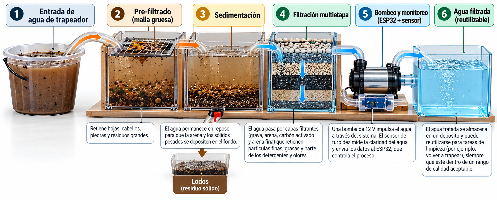
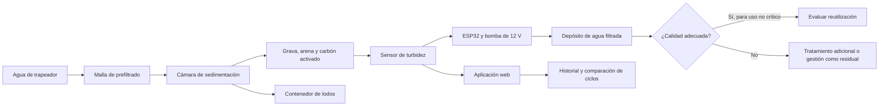
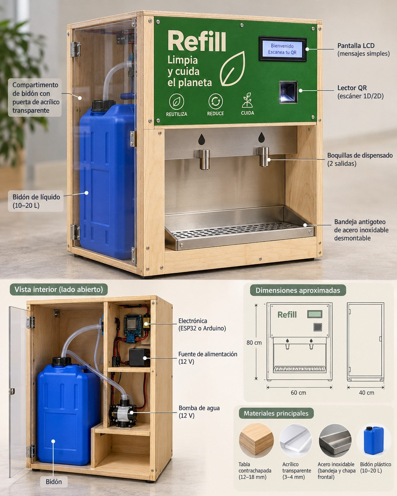
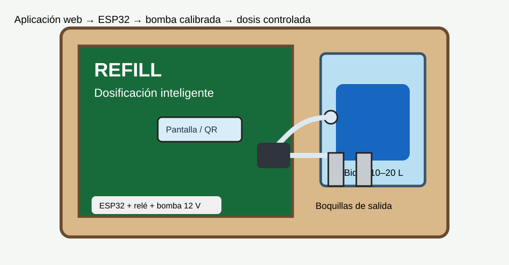
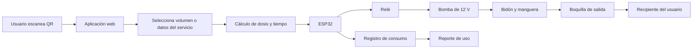

# Propuesta de solución: ExpoClean

## Resumen de la propuesta
ExpoClean propone **dos soluciones complementarias** para responder al Reto 4: optimizar el uso de productos químicos y reducir el impacto de las aguas grises generadas durante la limpieza.

1. **Filtración y pretratamiento de aguas grises:** separa sólidos y sedimentos del agua utilizada, la filtra por varias etapas y monitorea su turbidez para evaluar su posible recuperación.
2. **Dosificación inteligente:** evita la sobredosificación mediante una estación que dispensa una cantidad controlada de producto de limpieza.

La solución de dosificación actúa **antes y durante la limpieza**, reduciendo el desperdicio de químicos. La solución de filtración actúa **después de la limpieza**, disminuyendo parte de la carga física del agua residual y generando información para decidir si puede reutilizarse en actividades no críticas o si requiere tratamiento adicional.

> **Alcance técnico:** los prototipos demuestran dosificación controlada y pretratamiento físico. No se debe afirmar que el agua queda potable, libre de químicos o automáticamente autorizada para descarga. La calidad final debe verificarse con mediciones adecuadas y, cuando corresponda, análisis de laboratorio.

---

## Solución 1. Sistema inteligente de filtración y pretratamiento de aguas grises
image.png


### Descripción general

La segunda solución consiste en un sistema compacto, modular y de bajo costo para el pretratamiento de aguas grises generadas durante servicios de limpieza industrial y comercial.

El prototipo combina separación física, sedimentación, filtración multietapa, bombeo y monitoreo electrónico. Su propósito es reducir sólidos, sedimentos y turbidez antes de la descarga o de una posible reutilización en actividades de limpieza no críticas.



*Figura 2. Flujo conceptual del sistema: entrada, separación de residuos, sedimentación, filtración, bombeo, monitoreo y almacenamiento.*

### Problema que resuelve

Durante la limpieza se generan aguas con tierra, polvo, cabellos, arena, partículas orgánicas, grasas y residuos de detergentes o desinfectantes. Cuando se descargan sin separación previa, pueden aumentar la carga contaminante y transportar sólidos hacia el sistema de drenaje.

El sistema interviene antes de la descarga para separar residuos, reducir turbidez y obtener datos sobre el comportamiento del proceso.

### Funcionamiento paso a paso

#### Etapa 1. Entrada del agua residual

El operario deposita el agua utilizada durante la limpieza en un recipiente de entrada. El líquido se conduce hacia la primera cámara del sistema.

#### Etapa 2. Pre-filtrado de residuos gruesos

El agua atraviesa una malla removible que retiene cabellos, hojas, fibras, piedras y otros residuos de mayor tamaño. La malla puede retirarse para su limpieza y mantenimiento.

#### Etapa 3. Sedimentación

El agua ingresa a una cámara donde permanece en reposo. Por efecto de la gravedad, la arena y las partículas pesadas se depositan en el fondo como sedimentos o lodos. Una salida inferior permite retirarlos hacia un recipiente independiente.

#### Etapa 4. Filtración multietapa

El agua parcialmente clarificada atraviesa materiales con funciones diferentes:

- **Grava:** retiene partículas de mayor tamaño y distribuye el flujo.
- **Arena gruesa:** favorece la separación de sólidos intermedios.
- **Arena fina:** retiene partículas suspendidas más pequeñas.
- **Carbón activado:** puede adsorber determinados compuestos orgánicos, olores y algunos residuos químicos, dependiendo de sus características y del tiempo de contacto.
- **Malla de soporte:** evita que los materiales filtrantes sean arrastrados hacia la salida.

#### Etapa 5. Bombeo y monitoreo inteligente

Una bomba eléctrica de 12 V transporta el agua filtrada hacia el recipiente de almacenamiento. El ESP32 controla el encendido y apagado de la bomba. Un sensor de turbidez mide un indicador de la claridad del agua procesada y transmite los datos a la aplicación web ExpoClean.

Desde la aplicación, el usuario puede iniciar o detener el bombeo, visualizar la turbidez, consultar el estado del sistema, registrar la duración de cada ciclo y comparar resultados de diferentes procesos de filtración.

Para calcular el porcentaje de reducción de turbidez es necesario medir el agua de entrada y el agua de salida:

```text
Reducción de turbidez (%) =
(turbidez de entrada - turbidez de salida) / turbidez de entrada × 100
```

#### Etapa 6. Almacenamiento del agua filtrada

El agua procesada se almacena en un recipiente independiente. El resultado esperado es un líquido con menor concentración de sólidos suspendidos y menor turbidez que el agua inicial.

El agua podrá evaluarse para una posible reutilización en tareas de limpieza no críticas, siempre que cumpla los requisitos de calidad correspondientes. Si no alcanza las condiciones necesarias, deberá recibir tratamiento adicional o gestionarse como agua residual.

### Flujo de la solución 2



### Componentes principales

| Componente | Función |
|---|---|
| Recipiente de entrada | Almacena temporalmente el agua sucia. |
| Malla de prefiltrado | Retiene residuos gruesos. |
| Cámara de sedimentación | Separa partículas pesadas por gravedad. |
| Grava y arena | Retienen partículas suspendidas. |
| Carbón activado | Adsorbe determinados compuestos y olores. |
| Bomba de 12 V | Impulsa el agua hacia el depósito final. |
| ESP32 | Controla la bomba y recibe los datos del sensor. |
| Sensor de turbidez | Monitorea la claridad del agua. |
| Mangueras y conexiones | Transportan el agua entre las etapas. |
| Contenedor de lodos | Recoge los sedimentos separados. |
| Aplicación web | Permite controlar, visualizar y registrar los ciclos. |

---

## Integración de las dos soluciones

Las dos soluciones intervienen en momentos distintos del mismo problema ambiental:

```text
Dosificación controlada
        ↓
Menor desperdicio de químico en la limpieza
        ↓
Agua gris con menor carga evitable desde el origen
        ↓
Prefiltrado + sedimentación + filtración
        ↓
Monitoreo de turbidez y registro digital
        ↓
Evaluación de reúso no crítico o tratamiento adicional
```

### Diferenciación frente a soluciones existentes

Los dispensadores comerciales suelen resolver únicamente la entrega controlada del producto. Los sistemas de filtración, por otro lado, suelen actuar al final del proceso sin conocer cuánto químico se utilizó. ExpoClean integra ambos puntos:

| Aspecto | Soluciones convencionales | ExpoClean |
|---|---|---|
| Dosificación | Manual o dependiente de un dispensador aislado. | Aplicación web + ESP32 + bomba calibrada. |
| Agua utilizada | Generalmente no se registra ni se controla desde la receta. | Puede vincularse con la cantidad solicitada y el ciclo de limpieza. |
| Agua residual | Se descarga o se trata sin información del proceso que la generó. | Se prefiltra, sedimenta, filtra y monitorea. |
| Datos | Registros manuales o inexistentes. | Historial digital de dosificación, bombeo y turbidez. |
| Escalabilidad | Equipos propietarios o soluciones separadas. | Arquitectura modular con nuevas bombas y sensores. |
| Enfoque ambiental | Actúa en un solo punto. | Previene el desperdicio y gestiona el residuo posterior. |

El valor diferencial no es afirmar que ExpoClean inventa una bomba o un filtro. La innovación está en conectar **prevención, tratamiento físico, monitoreo y evidencia** en una solución modular y accesible para empresas de limpieza.

---

## Validación y resultados esperados

### Para la solución 1

- Comparar la cantidad dispensada manualmente con la cantidad dispensada por la estación.
- Medir el volumen real con una probeta o balanza.
- Calcular la exactitud de dosificación.
- Registrar la reducción de producto frente al método manual.

```text
Exactitud (%) = volumen medido / volumen solicitado × 100
Reducción de químico (%) =
(consumo manual - consumo ExpoClean) / consumo manual × 100
```

### Para la solución 2

- Medir la turbidez antes y después del filtrado.
- Registrar el volumen de agua procesada y la duración de cada ciclo.
- Observar la cantidad de sedimentos retenidos.
- Verificar el estado de los filtros y la necesidad de mantenimiento.
- Evaluar, con análisis adicionales, si el agua puede reutilizarse en limpieza no crítica.

Los porcentajes reales de reducción, el volumen procesado y la posibilidad de reúso deben determinarse mediante pruebas experimentales. El agua visualmente transparente no necesariamente está libre de detergentes, cloro, microorganismos u otros contaminantes.

## Limitaciones y consideraciones de seguridad

- El sistema de filtración es un **pretratamiento**, no una planta de potabilización.
- El carbón activado no elimina automáticamente todos los químicos presentes.
- Los filtros pueden saturarse y requieren limpieza o reemplazo periódico.
- La reutilización debe limitarse a usos no críticos hasta contar con resultados de calidad suficientes.
- No se deben mezclar cloro, ácidos, detergentes u otros químicos incompatibles.
- La descarga a alcantarillado o a un cuerpo de agua debe cumplir la normativa aplicable y las autorizaciones correspondientes.

## Conclusión

ExpoClean propone una estrategia de sostenibilidad en dos etapas. Primero, la estación inteligente evita la sobredosificación y registra el uso de productos de limpieza. Después, el sistema de filtración y pretratamiento separa sólidos, reduce turbidez y monitorea el agua gris generada.

En conjunto, las soluciones permiten pasar de un modelo de consumo y descarte a un modelo de **prevención, medición y recuperación responsable de recursos**, manteniendo claro que cualquier afirmación de reúso o cumplimiento ambiental debe respaldarse con mediciones técnicas.


---

## Solución 2. Estación inteligente de dosificación
image.png




### Descripción general

El primer prototipo consiste en una estación inteligente de dosificación de productos de limpieza, controlada mediante una aplicación web y un microcontrolador ESP32. Su objetivo es suministrar cantidades controladas de líquido, evitando el desperdicio de productos químicos y promoviendo un uso más eficiente de los recursos.

La estación recibe el producto desde un bidón, calcula o recibe la cantidad solicitada y activa una bomba de 12 V durante el tiempo necesario para entregar la dosis. El sistema se calibra previamente para relacionar el tiempo de funcionamiento de la bomba con el volumen dispensado.



*Figura 1. Estación conceptual con bidón, bomba, ESP32, lector QR, aplicación y boquillas de salida.*

### Funcionamiento paso a paso

1. **Ingreso del producto.** Se coloca un bidón con el producto de limpieza en el compartimento lateral de la estación. El bidón se conecta mediante una manguera a la bomba de dosificación.
2. **Identificación de la estación.** El usuario escanea el código QR de la estación y accede a la aplicación web de ExpoClean.
3. **Solicitud de la dosis.** El usuario selecciona la cantidad que necesita dispensar. En una versión ampliada, la aplicación puede calcularla según el área, tipo de superficie, nivel de suciedad, producto y dilución recomendada.
4. **Envío de la orden.** La aplicación transmite la instrucción al ESP32.
5. **Activación de la bomba.** El ESP32 activa un relé, que controla la alimentación de la bomba eléctrica de 12 V.
6. **Dispensación controlada.** La bomba transporta el líquido desde el bidón hasta la boquilla de salida. La cantidad se controla mediante el tiempo de funcionamiento de la bomba, previamente calibrada.
7. **Finalización y registro.** Cuando termina el tiempo programado, el ESP32 desactiva la bomba. La aplicación registra la cantidad estimada, el producto utilizado, la fecha y el ciclo de dispensación.

### ¿Cómo se determina la dosis?

En el prototipo inicial, la dosis se controla por tiempo. La relación se obtiene midiendo experimentalmente el caudal de la bomba:

```text
Tiempo de activación = Volumen solicitado / Caudal calibrado
```

Ejemplo:

```text
Volumen solicitado: 20 mL
Caudal calibrado:    5 mL/s
Tiempo de activación: 20 / 5 = 4 segundos
```

Esto significa que el ESP32 no mide directamente el volumen si todavía no se ha instalado un sensor de flujo; utiliza una calibración previa. Para aumentar la precisión en una siguiente versión, se incorporará un sensor de flujo y el sistema podrá detener la bomba cuando alcance el volumen real programado.

### Flujo de la solución 2



### Qué problema resuelve

- Reduce la dosificación manual “al ojo”.
- Evita entregar más producto del necesario.
- Disminuye el desperdicio de concentrado y la carga química generada en origen.
- Permite repetir una dosis con parámetros consistentes.
- Registra el consumo por producto, usuario, estación y jornada.

---
